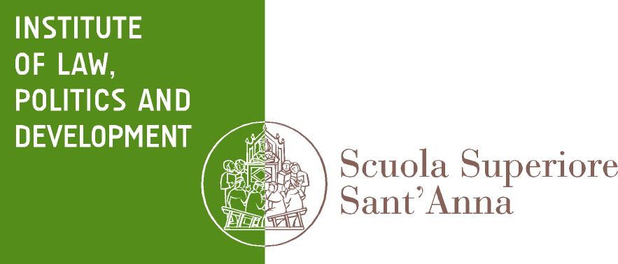

# Data Analysis in R using Agentic AI Assistants
Welcome to the GitHub repository for the Data Analysis in R class (AY 26/27). On this site, you will find code, data, and other material we will use in class.
## Syllabus
- [Syllabus](Syllabus.pdf)

## Before the first class
Please install the following before Friday 23 October:
- R: [cran.r-project.org](https://cran.r-project.org/)
- RStudio: [posit.co/download/rstudio-desktop](https://posit.co/download/rstudio-desktop/)
- OpenCode: [opencode.ai/download](https://opencode.ai/download). The desktop app is the simplest option. No account or paid subscription is needed; we will choose a model and connect OpenCode to your R project together in the first session.

Then download the course folder and unzip it somewhere you will find it again. We will open it in RStudio and OpenCode in the first session.
- [Course folder (zip)](Data-Analysis-in-R.zip)

No prior programming experience is assumed.

## Data and codebook
In the first part of the class, we will work with data on Tunisia. Below are the codebook and the data of a survey we fielded there in 2022 as well as data files containing the results of the 2014 and 2019 legislative elections in Tunisia.
- [Codebook Tunisia Survey](Codebook-TUN-Survey.pdf)
- [Data Tunisia Survey](tunisia_survey.csv)
- [2014 Electoral Results](res2014.csv)
- [2019 Electoral Results](res2019.csv)

## Sessions
| # | Date | Time | Topic |
|---|------|------|-------|
| 1 | Fri 23 Oct | 16:00–18:00 | Getting set up |
| 2 | Fri 30 Oct | 16:00–18:00 | Data management |
| 3 | Mon 2 Nov | 09:00–11:00 | Visualization |
| 4 | Mon 9 Nov | 16:00–18:00 | R programming |
| 5 | Mon 16 Nov | 16:00–18:00 | Exploring data |
| 6 | Mon 23 Nov | 16:00–18:00 | Linear regression |
| 7 | Mon 30 Nov | 09:00–11:00 | Replication I: U.S. Soft-Power and Foreign Policy Behavior (OLS) |
| 8 | Mon 7 Dec | 16:00–18:00 | Regression models for binary outcomes |
| 9 | Mon 14 Dec | 16:00–18:00 | Replication II: Does Counterbalancing Prevent Military Coups? (Logistic Regression) |

The final code file is due on the last day of class, Monday 14 December.

## Slides and code files
### Session 1: Getting set up
- [Slides session 1](Session-1-2026.pdf)
- Readings: Kennedy and Waggoner 2021, Introduction and Chapter 2.

### Session 2: Data management
- Readings: Kennedy and Waggoner 2021, Chapter 3.

### Session 3: Visualization
- Readings: Kennedy and Waggoner 2021, Chapter 4.
- [ggplot2 cheat sheet](https://github.com/rstudio/cheatsheets/blob/main/data-visualization.pdf)

### Session 4: R programming
- Readings: Kennedy and Waggoner 2021, Chapter 5.

### Session 5: Exploring data
- Readings: Kennedy and Waggoner 2021, Chapter 6.

### Session 6: Linear regression
- Readings: Kennedy and Waggoner 2021, Chapter 7 (focus on section 7.5 Ordinary Least Squares Regression).

### Session 7: Replication I: U.S. Soft-Power and Foreign Policy Behavior

We will reproduce the analysis in the article below. Make sure to read it carefully before class.

-  Goldsmith, Benjamin E. and Yusaku Horiuchi. 2012. "In Search of Soft Power: Does Foreign Public Opinion Matter for US Foreign Policy?" *World Politics* 64 (3): 555-585. [doi:10.1017/S0043887112000123](https://www.cambridge.org/core/journals/world-politics/article/in-search-of-soft-power-does-foreign-public-opinion-matter-for-us-foreign-policy/0C9DB5A0FB1EF43767932DE4E2C4DCEF)
-  The data are available [here](https://github.com/joshuaalley/cross-sectional-ols)

### Session 8: Regression models for binary outcomes
- Readings: Kennedy and Waggoner 2021, Chapter 7 (focus on section 7.6 Binary Response Models).

### Session 9: Replication II: Does Counterbalancing Prevent Military Coups?

We will reproduce the analysis in the article below. Make sure to read it carefully before class.

-  De Bruin, Erica. 2018. "Preventing Coups d'état: How Counterbalancing Works." *Journal of Conflict Resolution* 62 (7): 1433–58. [doi: 10.1177/0022002717692652](https://doi.org/10.1177/0022002717692652)
-  The data are available at the [journal website](https://journals.sagepub.com/doi/abs/10.1177/0022002717692652)

Slides and code for each session will be posted here before class.

## Previous years
- [AY 24/25 materials](AY_24-25.md)
