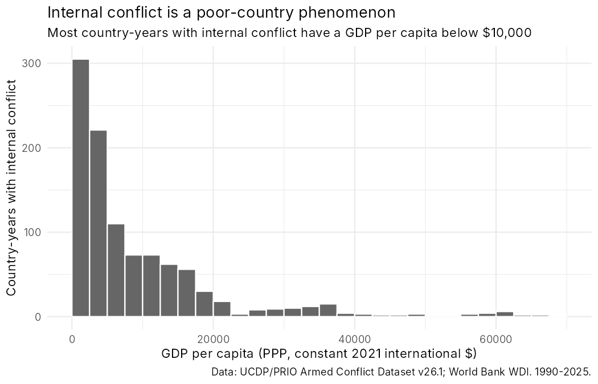
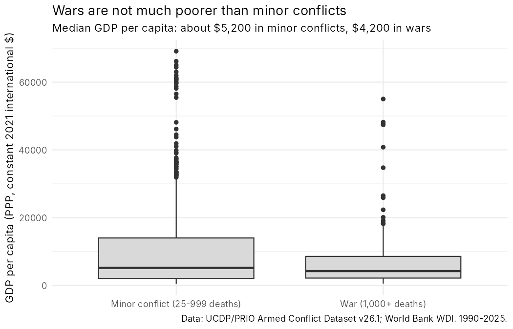
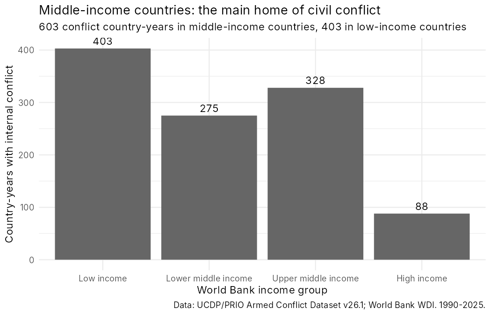
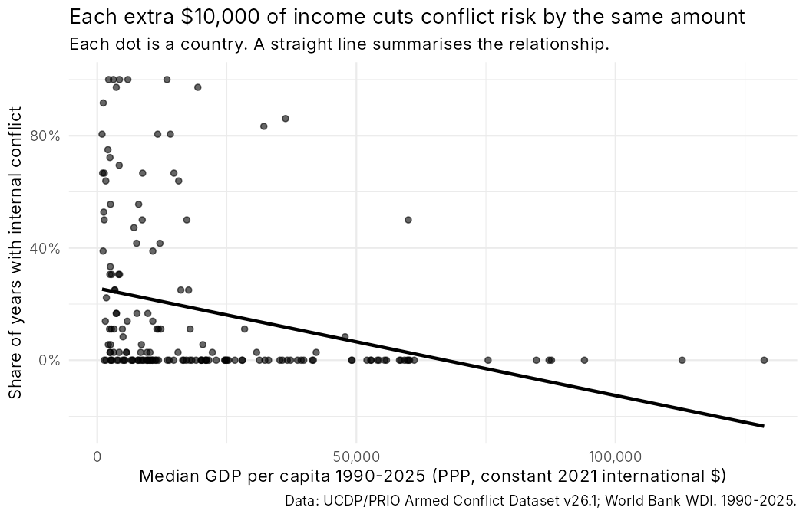
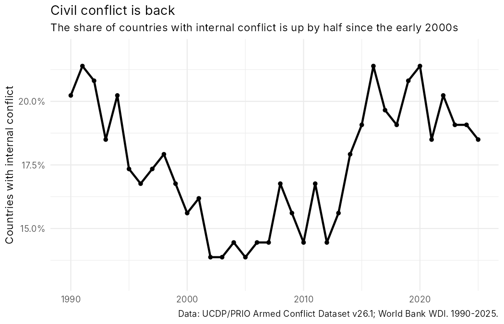
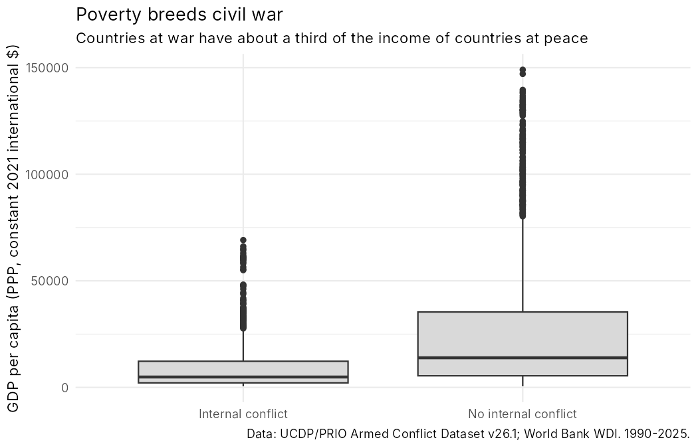

# Session 3: Correct, but misleading

Six figures, all made from the same table: every country in every year from 1990 to 2025, with an internal armed conflict (UCDP type 3 or 4) or not, and GDP per capita (World Bank, PPP, constant 2021 international $). This is the table the Session 2 lab should have produced.

**Every figure is correct.** The code runs, nothing is made up, and every number in a title or subtitle is true. Every figure is still misleading. Your job is to find out how.

## Setup

1. Download [`lab2_full_table.csv`](lab2_full_table.csv) into the `data/` folder of your course project.
2. Download the script for your figure (e.g. [`figure_1.R`](figure_1.R)) into your project folder.
3. Run it in RStudio. Look at the figure **and** at the Console.

## Your task, for each of your two figures

Work in your pair. Do steps 1 to 3 **without** the assistant.

1. **The claim.** In one sentence: what does the figure want you to believe?
2. **The problem.** Why is it misleading? Look at the code, the Console, the axes, and what is *not* in the picture.
3. **The fix.** What would an honest version show? Write the prompt you would give OpenCode to make it.
4. **Now ask the assistant.** Give OpenCode the script and ask: *"Is anything misleading about the figure this script makes?"* Did it find what you found? Did it find something you missed? Did it say there is no problem?
5. If there is time: send your fix prompt and check the new figure.

Write your answers in `notes/session3.md`.

## The table

| Column | Meaning |
|---|---|
| `country`, `iso3c`, `gwno` | World Bank country name, ISO-3 code, Gleditsch & Ward code |
| `year` | 1990 to 2025 |
| `gdppc` | GDP per capita, PPP, constant 2021 international $ (`NY.GDP.PCAP.PP.KD`). Empty = missing |
| `conflict` | 1 = at least one internal conflict (UCDP type 3 or 4) in this country-year, 0 = none |
| `n_conflicts` | number of internal conflicts in the country-year |
| `max_intensity` | 0 = no conflict, 1 = 25 to 999 battle deaths, 2 = 1,000 or more |
| `income_group` | World Bank income group, as given in the downloaded World Bank file |

6,228 rows = 173 countries × 36 years. Sources: UCDP/PRIO Armed Conflict Dataset v26.1; World Development Indicators (updated 8 October 2026).

---

## Figure 1

Script: [`figure_1.R`](figure_1.R)

## Figure 2

Script: [`figure_2.R`](figure_2.R)

## Figure 3

Script: [`figure_3.R`](figure_3.R)

## Figure 4

Script: [`figure_4.R`](figure_4.R)

## Figure 5

Script: [`figure_5.R`](figure_5.R)

## Figure 6

Script: [`figure_6.R`](figure_6.R)
